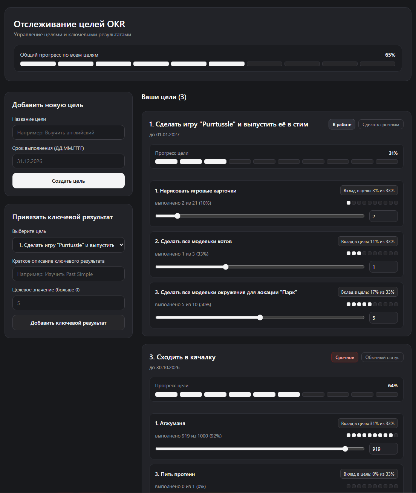
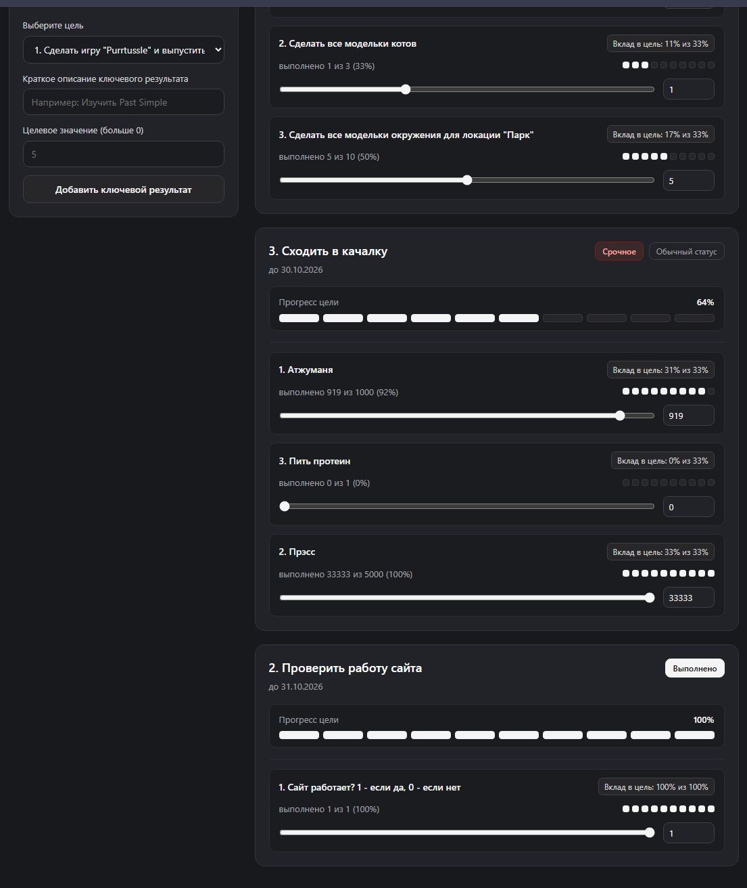

# Отслеживание целей OKR (Лабораторная работа №4, Вариант 18)

Решение содержит два проекта на языке **TypeScript** с использованием **React**, **Vite**, **ESLint** и **Jest**:

1. **`ui-library`** — библиотека UI-компонентов (`OkrGoalCard`, `KeyResultList`, `Button`, `Card`) и утилит расчёта прогресса OKR (покрытие тестами Jest — **100%**).
2. **`frontend`** — веб-приложение для управления целями и ключевыми результатами с автоматической сортировкой выполненных элементов и сохранением данных в `localStorage`.

## Структура проекта

```text
student-18/
├── ui-library/          # Библиотека UI-компонентов (@my-app/ui-library)
│   ├── src/
│   │   ├── OkrGoalCard/ # Компонент карточки цели OKR
│   │   ├── KeyResultList/ # Компонент списка ключевых результатов
│   │   ├── Button/      # Компонент кнопки
│   │   ├── Card/        # Компонент карточки
│   │   ├── okrUtils.ts  # Расчёт прогресса, вклада KR и валидация
│   │   └── index.ts     # Точка входа библиотеки
│   └── package.json
└── frontend/            # Презентационное веб-приложение
    ├── src/
    │   ├── App.tsx      # Дашборд целей и ключевых результатов
    │   └── main.tsx
    └── package.json
```

## Инструкция по установке и запуску

### Шаг 1. Установка и сборка `ui-library`

```bash
cd ui-library
npm install
npm run build
```

Доступные команды в `ui-library`:
- `npm run dev` — сборка в режиме отслеживания изменений (`watch`)
- `npm run build` — компиляция TypeScript и сборка пакета в `dist/`
- `npm run lint` / `npm run lint:fix` — проверка кода через ESLint
- `npm run test` / `npm run test:coverage` — запуск модульных тестов Jest с отчётом покрытия

### Шаг 2. Установка и запуск `frontend`

```bash
cd ../frontend
npm install
npm run dev
```

Доступные команды в `frontend`:
- `npm run dev` — запуск dev-сервера Vite (`http://localhost:5173`)
- `npm run build` — сборка фронтенд-приложения
- `npm run lint` / `npm run lint:fix` — проверка кода через ESLint
- `npm run test` / `npm run test:coverage` — запуск тестов Jest

## Примеры работы приложения

- Общий экран с формами добавления цели и ключевого результата:

- Выполненные цели и ключевые результаты уходят вниз:
